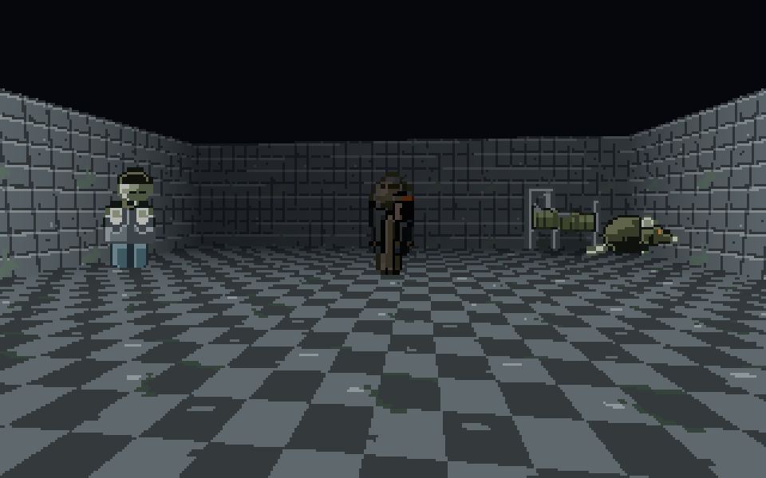

# billboard-crawler (fixture game)

Example game for artgen: a three.js first-person crawler with 8-direction billboard sprites, built only
through the committed install.

**Pitch.** *Hollow Ward* — a retro first-person crawler through a haunted asylum ward at night. Ghouls and
sleepwalking orderlies are 8-direction billboard sprites; rooms are lit by cold moonlight through barred windows and
the player's flickering lamp.

## Game

`src/main.ts` plays the exported pack (`public/assets/main/`) through the runtime vendored by
`node tools/artgen/artgen.js export --runtime` (`src/art/runtime/`, adapter set in `art/artgen.config.json`) and the
typed ids in `src/art/assets.ts`. The lines between the `// art` markers are all of its art code.

A ghoul (8-direction billboard, walk cycle) paces a circle in the ward while the view drifts round it the other way, so
its facing comes from the camera-relative angle; the floor and walls repeat the exported linoleum and ward-wall
textures, and beds, an IV stand, a wheelchair, the orderly, a rat and two flickering lamps stand around as billboards. The ghoul loads through the lit three.js adapter with its normal map, so the player's
lamp (a flickering point light at the camera) shades it.

A night warden walks a wider circle the other way as a **rigged 3D model** (R7b): `art/assets/character/warden` is a
3D-mode figure built along the shared biped rig (brief `rigged: true`, template `fp/character-rigged`), and
`node tools/artgen/artgen.js rig warden --out public/assets/models` writes `warden.rigged.glb`: the mesh skinned to the rig's
12 bones, a clip per state (idle, walk, attack, hurt) and three levels of detail. The game loads it with three's `GLTFLoader`
through the runtime's `riggedModel`, plays its walk, turns it along its path and stops it to strike when the ghoul comes near.
`npm run accept:rig` (in the image_tools checkout) builds this game and checks all of that in headless Chromium.
The warden itself is still in the pipeline: its finish waits for a blind review by a fresh reviewer, which the
authoring agent may not give itself, so its sprites are not in the pack yet; the model needs no approval to export.

```bash
npm install && npm run dev     # or, inside the image_tools checkout: node ../../node_modules/vite/bin/vite.js
```


